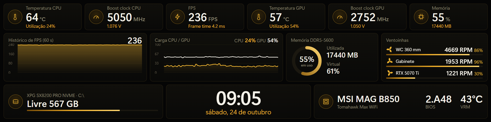

# ZeroDash

Dashboard de hardware em tempo real para o minimonitor **ZeroMOD 1920x480 (60 Hz)**.
Mostra CPU, GPU, **FPS**, memória, armazenamento, ventoinhas e placa-mãe em uma tela dedicada, com visual moderno (preto e dourado), baixo consumo e inicialização automática com o Windows.

> **Versão atual: 1.0.0** · Windows 10/11 x64 · feito para rodar **somente no monitor secundário ZeroMOD**



## Sumário
[Recursos](#recursos) · [Como funciona](#como-funciona) · [Requisitos](#requisitos) · [Compilar](#compilar) · [Executar e autostart](#executar-e-autostart) · [Monitor ZeroMOD](#rodando-exclusivamente-no-monitor-zeromod-1920x480) · [Layouts](#layouts) · [Adaptar ao seu hardware](#adaptar-ao-seu-hardware) · [Desempenho](#desempenho) · [Problemas comuns](#problemas-comuns) · [FAQ](#faq) · [Estrutura](#estrutura-do-repositório) · [Versionamento](#versionamento) · [Créditos](#licença-e-créditos)

## Recursos
- Dados da **CPU** (utilização, temperatura, boost clock, voltagem), **GPU** (utilização, temperatura, clock, voltagem), **memória** (uso, MB, virtual), **ventoinhas** (RPM e %), **disco** (espaço livre), **BIOS** e temperatura do VRM.
- **FPS** do jogo em execução, com histórico de 60 s (via RTSS).
- Gráficos de carga CPU/GPU, donut de memória, relógio e data.
- Janela **sem borda**, encaixada sozinha no monitor 1920x480; se ele não estiver ligado, a janela **não aparece** no monitor principal.
- Ícone na **bandeja do sistema** com menu (clique direito): nome/versão, **Iniciar com Windows** (liga/desliga), Recarregar e Sair. Instância única e `error.log` para falhas.
- Um único `ZeroDash.exe` com o layout embutido; layout editável sem recompilar.

## Como funciona
```
 LibreHardwareMonitorLib ─┐
 RTSS (memória comp.)  ───┼─►  ZeroDash.exe  ──►  http://127.0.0.1:5173  ──►  janela WebView2 no ZeroMOD
 Windows (RAM, discos)  ──┘   (coleta a 1 Hz)        /  e  /api/metrics         (HTML/CSS/JS embutido)
```
O coletor (C#/.NET 8) lê os sensores a cada 1 s, serve uma API JSON local e a interface (HTML) consome `/api/metrics` a cada 500 ms. O servidor escuta **apenas em 127.0.0.1**.

## Requisitos
**Hardware:** monitor ZeroMOD 1920x480 (ou qualquer tela exatamente 1920x480) como **segundo monitor**. Testado com Ryzen 7 7800X3D, RTX 5070 Ti e MSI MAG B850 Tomahawk Max WiFi.

**Software de terceiros:**

| Programa | Para quê | Onde obter |
|---|---|---|
| **RTSS** (RivaTuner Statistics Server) | Fonte do **FPS**. Precisa estar aberto e iniciar com o Windows. Já vem junto com o MSI Afterburner. | [Guru3D (site oficial)](https://www.guru3d.com/download/rtss-rivatuner-statistics-server-download/) |
| **PawnIO** | Driver que permite ler sensores da CPU e da placa-mãe (usado pela LibreHardwareMonitorLib). | [pawnio.eu](https://pawnio.eu/) ou `winget install --id namazso.PawnIO -e` |
| **.NET 8 Runtime** (ASP.NET Core + Desktop) | Executar o `ZeroDash.exe`. | [dotnet.microsoft.com/download/dotnet/8.0](https://dotnet.microsoft.com/download/dotnet/8.0) |
| **WebView2 Runtime** | Desenha a janela. Já vem no Windows 11. | [developer.microsoft.com/microsoft-edge/webview2](https://developer.microsoft.com/microsoft-edge/webview2/) |
| **.NET 8 SDK** | Só para **compilar**. | mesmo link do .NET |

A LibreHardwareMonitor é usada como **biblioteca** (NuGet): não precisa instalar o programa.
O ZeroDash roda **como administrador** (necessário para ler os sensores).

## Compilar
No PowerShell, na raiz do repositório:
```powershell
.\scripts\build.ps1
```
> **Erro de "política de execução" / "arquivo não assinado"?** Libere só a janela atual: `Set-ExecutionPolicy -Scope Process -ExecutionPolicy Bypass` e `Get-ChildItem -Recurse .\scripts | Unblock-File`. Ou rode: `powershell -ExecutionPolicy Bypass -File .\scripts\build.ps1`.

O resultado fica em `dist\ZeroDash-v1.0.0\` (`ZeroDash.exe`). O repositório também tem um workflow do GitHub Actions (`.github/workflows/build.yml`) que compila a cada push e publica um `.zip` na release ao criar uma tag `v*`.

## Executar e autostart
1. Feche o app se já estiver aberto e rode `dist\ZeroDash-v1.0.0\ZeroDash.exe` (confirma o UAC). A janela aparece no ZeroMOD e o ícone vai para a bandeja, perto do relógio.
2. **Clique direito no ícone da bandeja:**
   - **ZeroDash v1.0.0**: nome e versão (apenas informativo);
   - **Iniciar com Windows**: marcado = inicia sozinho 10 s após o logon, como administrador e sem UAC (cria/remove a tarefa agendada `ZeroDash`); desmarcado = não inicia;
   - **Recarregar**: recarrega a interface;
   - **Sair**: fecha o app.
3. Se mover a pasta do executável, desmarque e marque **Iniciar com Windows** de novo para apontar para o novo local.

## Rodando exclusivamente no monitor ZeroMOD (1920x480)
- O ZeroDash procura um monitor de **exatamente 1920x480** e posiciona a janela nele a cada 5 s. **Se não encontrar, a janela fica oculta** (nunca invade o monitor principal) e reaparece quando o ZeroMOD for conectado.
- No Windows, deixe o ZeroMOD como **"Estender estas telas"** (não duplicar), **escala 100%**, e **não** como monitor principal.
- O layout é fixo em 1920x480 e escala para outros tamanhos apenas ao abrir a URL no navegador.
- Opcional: ligar o ZeroMOD na saída de vídeo da **placa-mãe** (iGPU) deixa a GPU dedicada só para o jogo. Veja o [FAQ](#faq).

## Layouts
- **Padrão (dourado):** `src/ZeroDash/wwwroot/index.html` (embutido no exe).
- **Alternativo (preto/cinza/branco):** `layouts/black.html`. Para usar sem recompilar, copie-o para `wwwroot\index.html` **ao lado do `ZeroDash.exe`** (crie a pasta `wwwroot`) e use *Recarregar* na bandeja. Esse arquivo externo, se existir, tem prioridade sobre o embutido.
- Pré-visualizar no navegador sem hardware: abra o HTML com `?mock` no final (dados simulados).

## Adaptar ao seu hardware
Os IDs dos sensores ficam no topo de `src/ZeroDash/Program.cs`. Foram definidos a partir de um relatório da LibreHardwareMonitor da máquina de teste:

| Dado | ID (LibreHardwareMonitor) |
|---|---|
| Uso / temperatura / voltagem da CPU | `/amdcpu/0/load/0`, `/amdcpu/0/temperature/2`, `/lpc/nct6687dr/0/voltage/4` |
| Boost clock da CPU | maior clock `Core #N` de `/amdcpu/0/` |
| GPU (uso, temp., clock, voltagem) | `/gpu-nvidia/0/load/0`, `temperature/0`, `clock/0`, `voltage/0` |
| WC 360 / gabinete / fans da GPU | `/lpc/nct6687dr/0/fan/1` e `control/1`; `fan/10` e `control/10`; `/gpu-nvidia/0/fan/1` e `control/1` |
| Temperatura VRM | `/lpc/nct6687dr/0/temperature/2` |

Em outro PC, gere o relatório (LibreHardwareMonitor → *File → Save Report*), localize os sensores equivalentes, ajuste as constantes e recompile. Memória e discos vêm do Windows e não dependem de IDs. Os nomes de CPU/GPU/placa exibidos na interface estão no `index.html`.

## Desempenho
Coleta a 1 Hz; apenas CPU, GPU NVIDIA e placa-mãe são lidos (sem SMART de discos nem SPD de memória, para evitar micro-travamentos). A interface só anima `transform`/`opacity`. A janela WebView2 usa alguns processos `msedgewebview2.exe`; meça no seu jogo antes de concluir sobre consumo.

## Problemas comuns
| Sintoma | Causa provável / solução |
|---|---|
| Janela não aparece | ZeroMOD desligado, duplicado, em escala ≠ 100% ou resolução diferente de 1920x480. |
| Temperatura da CPU 0 / valores `--` | Falta o **PawnIO** ou o app não está como administrador; ou o ID do sensor não existe na sua máquina. |
| FPS sempre 0 | RTSS fechado ou jogo não detectado (o overlay do RTSS deve aparecer no jogo). |
| Erro ao abrir | Veja `error.log` ao lado do exe; confira os runtimes do .NET 8 e do WebView2. |
| Anticheat reclama | Qualquer leitor de sensores com driver e o RTSS podem ser restringidos por anticheats de kernel. Teste antes de jogar online. |

## FAQ
**Ligar o monitor na placa-mãe (iGPU) em vez da RTX muda o que funciona?**
Não: sensores, FPS e layout funcionam igual nos dois casos. É principalmente **desempenho e eficiência**. Na GPU dedicada, o monitor extra mantém a RTX compondo mais uma tela (pode aumentar um pouco o uso e o consumo em repouso; não medi o efeito). Na iGPU (Ryzen), a RTX fica só para o jogo; o custo é usar uma pequena parte da RAM como memória de vídeo e depender de a iGPU estar ativa na BIOS e de a placa ter saída de vídeo. Se o app que desenha o dashboard preferir a RTX, o Windows copia quadros entre as duas GPUs; em *Configurações → Sistema → Tela → Elementos gráficos*, defina `ZeroDash.exe` e `msedgewebview2.exe` como *Economia de energia*.

## Estrutura do repositório
```
ZeroDash/
├─ src/ZeroDash/          código-fonte (Program.cs, ZeroDash.csproj, app.manifest, zerodash.ico, wwwroot/index.html)
├─ layouts/               layouts alternativos
├─ assets/icons/          ícone original (PNG 128x128)
├─ scripts/               build.ps1
├─ docs/screenshots/      prints para o README
├─ .github/workflows/     build automático (GitHub Actions)
├─ CHANGELOG.md · LICENSE · .gitignore · .gitattributes
└─ dist/                  saída da compilação (ignorada pelo git)
```
O `zerodash.ico` foi gerado a partir de `assets/icons/zerodash.png` (tamanhos 16 a 128 px).

## Versionamento
[SemVer](https://semver.org/lang/pt-BR/). A versão fica em `<Version>` no `ZeroDash.csproj` e aparece no tooltip da bandeja. Para lançar: atualize o `.csproj` e o `CHANGELOG.md`, faça o commit e crie a tag:
```powershell
git tag v1.0.0; git push origin v1.0.0
```

## Licença e créditos
[MIT](LICENSE). Usa [LibreHardwareMonitor](https://github.com/LibreHardwareMonitor/LibreHardwareMonitor) (MPL-2.0), [PawnIO](https://pawnio.eu/), [Microsoft WebView2](https://developer.microsoft.com/microsoft-edge/webview2/) e o RTSS (Alexey Nicolaychuk "Unwinder" / Guru3D). Marcas citadas pertencem aos seus respectivos donos.
